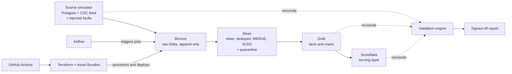

# LedgerShift

**A data platform migration with proof it worked.**
Migrate a legacy Postgres system (orders, payments, customers) to a **Databricks lakehouse** (Delta, bronze/silver/gold) with a **Snowflake** serving layer, then *prove* the migration is correct, fast, governed and operable.

> This is not a dashboard or a website. It is the engineering around a migration: fault-injected source data, incremental pipelines, a reconciliation engine, workspace-as-code, orchestration, CI/CD, performance benchmarks, failure drills and a handover pack.

---

## 1. What this project demonstrates

| Capability | Where it lives | Evidence a reviewer can open |
|---|---|---|
| Data quality problem solving | `src/generator`, `src/pipelines/silver` | Fault catalogue + quarantine tables |
| ETL/ELT with Spark | `src/pipelines` | Tested bronze/silver/gold jobs |
| Snowflake integration | `src/snowflake` | Load job, window-function SQL, secure view |
| Migration with integrity | `src/validation` | `docs/validation/report.md` (signed-off reconciliation) |
| Administration and governance | `infra/terraform` | Groups, cluster policies, Unity Catalog grants |
| Orchestration and automation | `orchestration/airflow` | DAG with retries, SLA and alerting |
| CI/CD | `.github/workflows`, `databricks.yml` | Green pipeline, dev/prod deploy |
| Performance tuning | `src/perf_lab` | `docs/benchmarks/results.md` (before/after numbers) |
| Troubleshooting | `docs/runbooks` | Failure drills with diagnosis and fix |
| Documentation and handover | `docs/` | Architecture, ADRs, deployment guide, handover |

## 2. Architecture



## 3. Honest scope statement (keep this section accurate)

Fill this table in as you go. Never claim something that was not actually run.

| Item | Tested on | Applied on |
|---|---|---|
| PySpark pipelines | Local Spark + Databricks Free Edition | Databricks Free Edition |
| Terraform (UC, groups, policies) | `terraform validate` / `plan` | _fill in: paid/trial workspace or "plan only"_ |
| Snowflake load | Snowflake trial | Snowflake trial |
| Airflow | Docker Compose (local) | Local |
| CI/CD | GitHub Actions | _dev only / dev+prod_ |

Databricks Free Edition has limited admin features (serverless-focused). Check current limits yourself. Real cluster policies, networking and metastore admin need a paid or trial cloud workspace (Azure/AWS/GCP).

## 4. Full repository tree

```
ledgershift/
├── README.md
├── LICENSE
├── pyproject.toml
├── Makefile
├── .gitignore
├── .env.example
├── .pre-commit-config.yaml
├── databricks.yml                      # Databricks Asset Bundle (root, per CLI convention)
│
├── .github/
│   └── workflows/
│       ├── ci.yml                      # lint + unit tests + terraform validate
│       └── deploy.yml                  # bundle deploy dev -> prod (manual approval)
│
├── infra/
│   └── terraform/
│       ├── providers.tf
│       ├── variables.tf
│       ├── main.tf                     # groups, users, workspace config
│       ├── unity_catalog.tf            # catalogs, schemas, volumes
│       ├── grants.tf                   # least-privilege grants
│       ├── cluster_policies.tf
│       ├── jobs.tf
│       ├── outputs.tf
│       └── envs/
│           ├── dev.tfvars
│           └── prod.tfvars
│
├── src/
│   └── ledgershift/
│       ├── __init__.py
│       ├── config.py                   # env-driven settings
│       ├── spark.py                    # SparkSession factory (local vs Databricks)
│       ├── generator/
│       │   ├── __init__.py
│       │   ├── models.py               # customers, orders, payments schemas
│       │   ├── seed.py                 # initial snapshot generator
│       │   ├── cdc.py                  # insert/update/delete change stream
│       │   ├── faults.py               # fault injection catalogue
│       │   └── cli.py
│       ├── pipelines/
│       │   ├── __init__.py
│       │   ├── bronze.py               # raw ingest, Auto Loader / file ingest
│       │   ├── silver.py               # clean, dedupe, MERGE, quarantine
│       │   ├── scd2.py                 # slowly changing dimensions
│       │   ├── gold.py                 # facts, marts
│       │   └── quality.py              # expectations, quarantine rules
│       ├── snowflake/
│       │   ├── __init__.py
│       │   ├── load.py                 # Spark -> Snowflake connector
│       │   └── sql/
│       │       ├── 01_schemas.sql
│       │       ├── 02_tables.sql
│       │       ├── 03_streams_tasks.sql
│       │       ├── 04_analytics_window.sql
│       │       └── 05_secure_views.sql
│       ├── validation/
│       │   ├── __init__.py
│       │   ├── checks.py               # row counts, checksums, profiles, sample diff
│       │   ├── adapters.py             # Postgres / Delta / Snowflake readers
│       │   ├── runner.py
│       │   └── report.py               # markdown + JSON report, sign-off
│       └── perf_lab/
│           ├── __init__.py
│           ├── slow_job.py             # deliberately bad version
│           ├── fast_job.py             # tuned version
│           └── benchmark.py            # timing harness -> results table
│
├── orchestration/
│   └── airflow/
│       ├── docker-compose.yml
│       ├── dags/
│       │   ├── ledgershift_daily.py
│       │   └── ledgershift_validation.py
│       └── plugins/
│
├── notebooks/                          # exploratory only, no business logic
│   └── 00_explore.ipynb
│
├── tests/
│   ├── conftest.py                     # local Spark fixture
│   ├── unit/
│   │   ├── test_faults.py
│   │   ├── test_silver.py
│   │   ├── test_scd2.py
│   │   └── test_validation_checks.py
│   └── integration/
│       └── test_end_to_end_local.py
│
├── data/                               # git-ignored: generated output
│   └── .gitkeep
│
└── docs/
    ├── architecture.md
    ├── data-model.md
    ├── adr/
    │   ├── 0001-delta-lakehouse.md
    │   ├── 0002-medallion-layers.md
    │   ├── 0003-partitioning-and-clustering.md
    │   └── 0004-validation-strategy.md
    ├── runbooks/
    │   ├── drill-01-schema-drift.md
    │   ├── drill-02-duplicate-flood.md
    │   ├── drill-03-skewed-join.md
    │   ├── drill-04-failed-merge.md
    │   └── drill-05-permission-denied.md
    ├── benchmarks/
    │   └── results.md
    ├── validation/
    │   └── report.md
    ├── deployment-guide.md
    ├── handover.md
    └── images/
```

## 5. Prerequisites (Windows 11 + VS Code)

**Core**
- Git, GitHub account, `gh` CLI
- WSL2 + Ubuntu: `wsl --install` (run Spark and Airflow inside WSL)
- Docker Desktop with WSL2 backend
- Java 17 (Temurin) inside WSL: `sudo apt install openjdk-17-jdk`
- Python 3.11 or 3.12 and `uv` (or `venv`)

**CLIs**
- Databricks CLI: `winget install Databricks.DatabricksCLI`
- Terraform
- Snowflake CLI: `pip install snowflake-cli`
- Azure CLI or AWS CLI (whichever cloud you use)

**VS Code extensions**
Databricks, Python, Pylance, Jupyter, Ruff, HashiCorp Terraform, Docker, WSL, YAML, GitLens, SQLTools (or Snowflake extension).

**Accounts**
Databricks Free Edition, GitHub, and a Snowflake 30-day trial (**start it late**, when pipelines are ready, so it does not expire).

**Cap WSL memory** (`C:\Users\<you>\.wslconfig`), important on a 16 GB laptop:

```ini
[wsl2]
memory=8GB
processors=6
```

Then run `wsl --shutdown` and reopen.

## 6. Quick start

```bash
git clone https://github.com/<you>/ledgershift.git && cd ledgershift
uv venv && source .venv/bin/activate
uv pip install -e ".[dev]"
cp .env.example .env
make test            # local Spark unit tests
make generate        # seed data + CDC batch with faults
make pipeline-local  # bronze -> silver -> gold on local Delta
make validate        # reconciliation report
```

---

## 7. Milestones: plan, implement, prove

Work in this order. Each milestone ends with something demoable and a commit/tag (`v0.1` ... `v1.0`). Do not start the next one until the "Definition of done" is met.

**Planning habit for every milestone:** (1) open a GitHub Issue with acceptance criteria, (2) branch `feat/mX-name`, (3) write the test first where practical, (4) PR into `main` with a short note on what you proved, (5) tag.

### M0: Foundations (0.5 to 1 day)

**Goal:** a clean repo that lints, tests and runs Spark locally.

Tasks
1. Create repo, add `.gitignore` (venv, `data/`, `.env`, `.terraform/`, `*.tfstate*`).
2. Write `pyproject.toml`:

```toml
[project]
name = "ledgershift"
version = "0.1.0"
requires-python = ">=3.11"
dependencies = [
  "pyspark>=3.5",
  "delta-spark>=3.2",
  "faker",
  "pydantic-settings",
  "pyyaml",
]

[project.optional-dependencies]
dev = ["pytest", "ruff", "pre-commit", "great-expectations"]
cloud = ["databricks-sdk", "databricks-connect", "snowflake-connector-python", "snowflake-snowpark-python"]

[tool.ruff]
line-length = 100

[tool.pytest.ini_options]
testpaths = ["tests"]
```

3. `src/ledgershift/spark.py`: one factory so code runs locally and on Databricks.

```python
from pyspark.sql import SparkSession
from delta import configure_spark_with_delta_pip

def get_spark(app: str = "ledgershift") -> SparkSession:
    try:  # on Databricks a session already exists
        from pyspark.dbutils import DBUtils  # noqa: F401
        return SparkSession.builder.getOrCreate()
    except ImportError:
        builder = (
            SparkSession.builder.appName(app)
            .master("local[4]")
            .config("spark.sql.extensions", "io.delta.sql.DeltaSparkSessionExtension")
            .config("spark.sql.catalog.spark_catalog",
                    "org.apache.spark.sql.delta.catalog.DeltaCatalog")
            .config("spark.sql.shuffle.partitions", "8")
        )
        return configure_spark_with_delta_pip(builder).getOrCreate()
```

4. `tests/conftest.py` with a session-scoped Spark fixture; one smoke test that writes and reads a Delta table.
5. `.pre-commit-config.yaml` with ruff; `Makefile` targets: `test`, `lint`, `generate`, `pipeline-local`, `validate`.
6. `ci.yml`: install, `ruff check`, `pytest`.

Definition of done: `make test` green locally and in GitHub Actions.

### M1: Source simulator with fault injection (1 to 2 days)

**Goal:** realistic data that is deliberately dirty, reproducible via a seed.

Tasks
1. `models.py`: schemas for `customers`, `orders`, `order_items`, `payments` (keys, FKs, timestamps, amounts as decimals).
2. `seed.py`: Faker-based snapshot; `--customers 100000 --orders 1000000 --seed 42`. Write Parquet/CSV to `data/source/snapshot/`.
3. `cdc.py`: produce change batches `data/source/cdc/batch_0001/` with columns `op` (`I/U/D`), `ts`, `lsn`, and the row image.
4. `faults.py`: a registry of faults, each a pure function with a configurable rate and a recorded manifest (what was injected, where):

| Fault | Description |
|---|---|
| `duplicate_rows` | Same business key repeated |
| `late_arriving` | CDC event timestamp older than already-processed data |
| `out_of_order` | Update arrives before its insert |
| `null_required` | Nulls in non-nullable fields |
| `bad_type` | `"abc"` in numeric column, malformed dates |
| `schema_drift` | New column appears / column renamed in a later batch |
| `orphan_fk` | Payment referencing a missing order |
| `negative_amount` | Invalid business values |

5. Write the **fault manifest** (`faults_manifest.json`). Later, validation and silver must account for every injected fault. This is what makes the project verifiable.
6. `cli.py`: `python -m ledgershift.generator.cli seed|cdc|inject`.

Tests: same seed gives identical output; each fault changes exactly the expected number of rows.

Definition of done: a reproducible dataset plus a manifest listing exact fault counts.

### M2: Bronze and silver pipelines, local (2 to 3 days)

**Goal:** incremental, idempotent medallion pipelines running on local Delta.

Tasks
1. **Bronze** (`bronze.py`): append-only raw ingest with metadata columns `_ingest_ts`, `_source_file`, `_batch_id`. Keep raw values as strings where types are unsafe. Never drop data here.
2. **Silver** (`silver.py`):
   - Cast and validate types; rows failing rules go to `silver.quarantine_<table>` with a `_reject_reason`.
   - Deduplicate with a window (`row_number() over (partition by key order by lsn desc)`).
   - Apply CDC with `MERGE` (handle `I/U/D`, ignore stale events using `lsn`/`ts`).
3. **SCD2** (`scd2.py`) for `dim_customer`: `valid_from`, `valid_to`, `is_current`, using MERGE with a staged "expire + insert" pattern.
4. **Schema drift handling:** explicit policy (add new nullable columns via `mergeSchema`, alert on renames) documented in an ADR.
5. Idempotency: re-running the same batch must not change results (batch-id ledger table).

Core MERGE sketch:

```python
from delta.tables import DeltaTable

def merge_cdc(spark, target_path: str, updates_df, key: str = "order_id"):
    tgt = DeltaTable.forPath(spark, target_path)
    (tgt.alias("t")
        .merge(updates_df.alias("s"), f"t.{key} = s.{key}")
        .whenMatchedDelete(condition="s.op = 'D' AND s.lsn >= t.lsn")
        .whenMatchedUpdateAll(condition="s.op <> 'D' AND s.lsn > t.lsn")
        .whenNotMatchedInsertAll(condition="s.op <> 'D'")
        .execute())
```

Tests (`tests/unit`): dedupe keeps the latest; delete removes; stale update ignored; SCD2 closes the old row and opens a new one; quarantine row counts equal fault manifest counts.

Definition of done: running `make pipeline-local` twice yields identical tables; quarantine plus clean rows equals input rows.

### M3: Gold layer and the validation engine (2 to 3 days)

**Goal:** the centerpiece. Prove source and target agree.

Tasks
1. **Gold** (`gold.py`): `fact_orders`, `fact_payments`, `dim_customer`, and a mart such as `mart_daily_revenue`.
2. **Validation checks** (`checks.py`), each returns a structured result `{name, table, status, expected, actual, detail}`:
   - **Row count** per table (source vs target, accounting for known quarantined rows).
   - **Aggregate checks**: `sum(amount)`, `min/max(date)`, distinct key counts.
   - **Column checksums**: hash per column (e.g., `sum(xxhash64(cast(col as string)))`) so you detect silent value changes without comparing every row.
   - **Null and distinct profiles** per column, compared within tolerance.
   - **Sampled row diff**: deterministic sample by key hash bucket; list mismatching columns.
   - **Referential integrity** on gold.
3. `adapters.py`: readers for Postgres (or the source Parquet), Delta, and later Snowflake, so the same checks run against any pair.
4. `report.py`: output `docs/validation/report.md` and `report.json` with a summary table, per-check detail, **fault reconciliation** (injected vs detected vs quarantined), and a sign-off block (run id, git SHA, timestamp, verdict PASS/FAIL).
5. `runner.py`: `python -m ledgershift.validation.runner --source ... --target ...`; non-zero exit code on FAIL (CI and Airflow can gate on it).

Tests: unit-test each check on tiny frames, including a "tampered target" case that must FAIL.

Definition of done: a committed sample report showing PASS, plus a second report showing a deliberately tampered table caught as FAIL.

### M4: Move to Databricks (1 to 2 days)

**Goal:** same code, running in the workspace.

Tasks
1. `databricks auth login` (profile `dev`); configure Databricks Connect or run via bundle jobs.
2. Create Unity Catalog structure `ledgershift_dev.{bronze,silver,gold,ops}` (manually first; Terraform in M6).
3. Upload generated data to a Volume; point `config.py` at catalog paths via env vars.
4. Replace path-based Delta with table names (`saveAsTable`/`MERGE INTO catalog.schema.table`) behind a small storage helper.
5. Run the full pipeline and validation in the workspace; capture screenshots/job-run links for `docs/`.

Definition of done: bronze to gold completes in Databricks and the validation report is PASS.

### M5: Snowflake serving layer (1 to 2 days)

**Goal:** gold tables served from Snowflake, validated against the lakehouse.

Tasks
1. Start the Snowflake trial now. Create warehouse (X-Small, auto-suspend 60s), database, schemas, a role for the loader and a role for analysts.
2. `load.py`: write gold to Snowflake via the Spark connector (keep credentials in env/secret scope, never in code).
3. SQL files in `src/ledgershift/snowflake/sql/`:
   - `03_streams_tasks.sql`: a stream on a loaded table and a task that maintains a derived table.
   - `04_analytics_window.sql`: running revenue, customer rank, month-over-month with `LAG`, `RANK`, `SUM() OVER`.
   - `05_secure_views.sql`: secure view that masks sensitive columns by role.
4. Add a Snowflake adapter to the validation engine; reconcile Delta gold vs Snowflake tables.

Definition of done: validation report includes a Delta-vs-Snowflake section with PASS.

### M6: Workspace as code: Terraform (2 days)

**Goal:** administration and governance expressed as reviewed code.

Tasks
1. `providers.tf` (Databricks provider, auth via env); remote state later (S3/Azure Blob) or local state git-ignored for the portfolio.
2. Resources:
   - `databricks_group` (`data_engineers`, `analysts`, `ops`)
   - `databricks_catalog`, `databricks_schema` per layer and environment
   - `databricks_grants`: engineers write bronze/silver, analysts read gold only
   - `databricks_cluster_policy`: cap node types, force auto-termination, require tags
   - `databricks_job` definitions for the pipelines
3. `envs/dev.tfvars` and `prod.tfvars`.
4. CI step: `terraform fmt -check`, `validate`, `plan` (plan output saved as an artifact).
5. Fill in the honest scope table: what was applied vs plan-only.

Definition of done: `terraform validate` and `plan` clean in CI; permission model documented in `docs/architecture.md`.

### M7: Orchestration with Airflow (1 to 2 days)

**Goal:** scheduled, retried, observable runs.

Tasks
1. `docker-compose.yml` based on the official Airflow compose; mount `dags/`.
2. DAG `ledgershift_daily`: `generate/ingest -> bronze -> silver -> gold -> snowflake_load -> validate` using the Databricks provider operators (`DatabricksRunNowOperator`).
3. Add `retries=3`, exponential backoff, `sla`, failure callback (Slack/email webhook or log alert), and a gate that fails the DAG if validation FAILs.
4. Pass a `batch_id` between tasks so reruns are idempotent.
5. DAG tests: import test (no cycles, no import errors).

Definition of done: a successful DAG run screenshot plus a deliberately failed run showing retry and alert.

### M8: CI/CD with Databricks Asset Bundles (1 to 2 days)

**Goal:** push to GitHub, get tested code deployed.

Tasks
1. `databricks.yml` with `dev` and `prod` targets, jobs referencing `src/`.
2. `ci.yml`: ruff, pytest, `terraform validate`, `databricks bundle validate`.
3. `deploy.yml`: on merge to `main`, `databricks bundle deploy -t dev`; manual approval (GitHub Environment) for `prod`.
4. Store secrets in GitHub Secrets (`DATABRICKS_HOST`, `DATABRICKS_TOKEN` or OIDC); never commit them.
5. Add status badges to this README.

Definition of done: a merged PR triggers lint, tests and a dev deploy automatically.

### M9: Performance lab (2 days)

**Goal:** measurable before/after tuning with numbers.

Tasks
1. `slow_job.py`: intentionally bad: many tiny files, skewed join key (one customer owns a large share of orders), no partition pruning, Python UDF, wide shuffle.
2. `fast_job.py`: the same output, tuned:
   - Adaptive Query Execution on, skew join handling
   - Broadcast join for the small dimension
   - Replace UDF with built-in functions
   - `OPTIMIZE` (compaction) and liquid clustering / `ZORDER` on filter columns
   - Right-sized shuffle partitions
3. `benchmark.py`: run each N times, record wall time, shuffle read/write, files scanned, bytes read; assert outputs are identical (checksum) so the speedup is honest.
4. Publish `docs/benchmarks/results.md`:

| Scenario | Before | After | Change | Technique |
|---|---|---|---|---|
| Skewed join | _s | _s | _x | AQE skew + broadcast |
| Small files | _ files | _ files | | OPTIMIZE |
| Filter query | _ MB read | _ MB read | | clustering/pruning |

Definition of done: a results table with real measured numbers and the Spark UI evidence saved in `docs/images/`.

### M10: Failure drills, runbooks, docs and handover (2 days)

**Goal:** show you can troubleshoot independently and hand over cleanly.

Drills (each gets `docs/runbooks/drill-0X-*.md` with: symptom, how detected, root cause, fix, prevention)
1. Schema drift breaks bronze to silver
2. Duplicate flood corrupts a MERGE
3. Skewed join stalls a stage
4. MERGE fails on multiple source matches
5. Permission denied after grant change

Docs
- `architecture.md` with the diagram and data flow
- ADRs 0001 to 0004 (context, decision, consequences)
- `deployment-guide.md`: from clean machine to running pipeline
- `handover.md`: what exists, how to operate it, known limits, next steps
- A 3 to 5 minute demo video: generator, pipeline run, validation FAIL then PASS, benchmark table

Definition of done: someone who has never seen the repo can deploy it using only the docs.

---

## 8. Optional stretch goals

- Kafka (or Redpanda in Docker) as the CDC transport instead of files
- Structured Streaming / Auto Loader for the bronze layer
- Great Expectations suites wired into silver
- Data lineage and access-audit queries via Unity Catalog system tables
- A Scala UDF or job for one transformation

## 9. Timeline (about 3 to 4 weeks part-time)

| Week | Milestones |
|---|---|
| 1 | M0, M1, M2 |
| 2 | M3, M4 |
| 3 | M5, M6, M7 |
| 4 | M8, M9, M10, polish |

## 10. Definition of done for the whole project

- [ ] `make test` and CI green
- [ ] Validation report committed: PASS, plus a tampered FAIL example
- [ ] Benchmarks table with real numbers
- [ ] Terraform validates; honest scope table filled
- [ ] Airflow success and failure screenshots
- [ ] 5 runbooks, 4 ADRs, handover doc
- [ ] No secrets in git history (`git log -p | grep -i token`)
- [ ] Demo video linked at the top of this README

## 11. License

MIT


## M4–M5 implementation update (2026-10-22)

Repository artifacts added for Databricks Asset Bundles and Snowflake serving:

- `databricks.yml` defines dev/prod targets and `resources/ledgershift.yml` declares pipeline and reconciliation jobs.
- `src/ledgershift/snowflake/load.py` provides environment-driven connector options and a DataFrame writer.
- `src/ledgershift/snowflake/sql/` now contains serving schemas/tables, stream/task merge pattern, window analytics, and a secure analyst view.
- `tests/unit/test_snowflake_load.py` covers required settings and invalid load inputs.
- `docs/deployment-m4-m5.md` and `docs/validation/m4-m5-acceptance.md` document deployment and evidence requirements.

**Status: implementation scaffold committed; cloud verification pending.** Databricks bundle validation/deployment, Spark connector compatibility, Snowflake SQL execution, and Delta-to-Snowflake reconciliation have not been verified by these repository writes. The bundle job paths and the task warehouse must be checked against the actual workspace/account before deployment. Do not treat the milestones as complete until the acceptance checklist has recorded real run evidence.


## M6–M8 implementation update (2026-10-22)

Added implementation scaffolding on branch `feat/m6-m8-governance-orchestration-cicd`:

- M6: Terraform provider/version pinning, typed variables, Unity Catalog catalog and bronze/silver/gold/ops schemas, governance groups, grants and outputs; safe environment variable examples.
- M7: scheduled Airflow DAG invoking the bundled Databricks job with retries, exponential backoff, serialized runs and an idempotency token.
- M8: CI jobs for Python lint/tests, Terraform format/validation and bundle validation; deployment workflow for dev and manually approved production environment; deployment/acceptance guide.

**Status: implementation scaffold only; cloud and CI verification pending.** Terraform has not been initialized or validated in this environment, Airflow has not been run, and GitHub Actions or Databricks deployments have not been observed. Configure GitHub `production` required reviewers, workspace secrets and Airflow's `databricks_default` connection before operating these workflows. Review provider-version/resource compatibility and the exact bundle job parameter contract before applying infrastructure.
